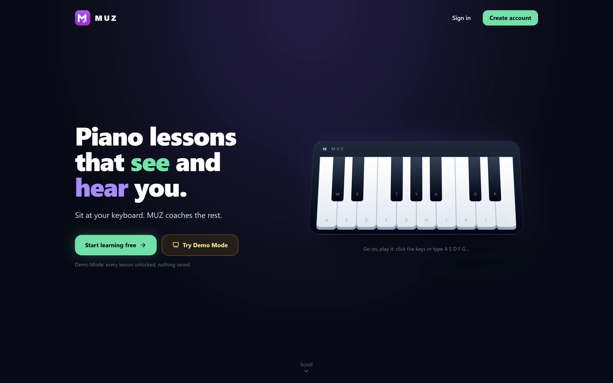
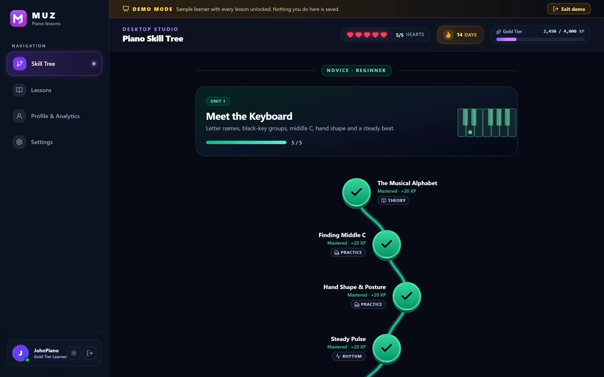
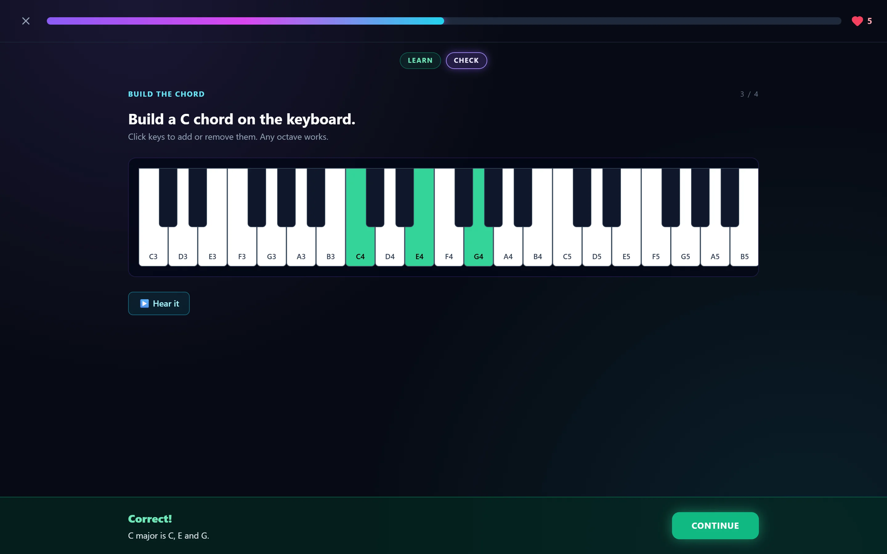
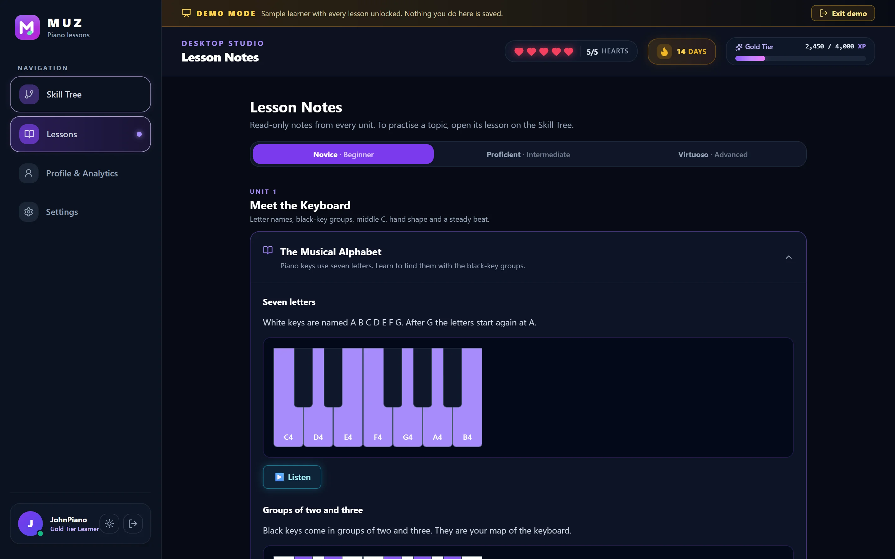
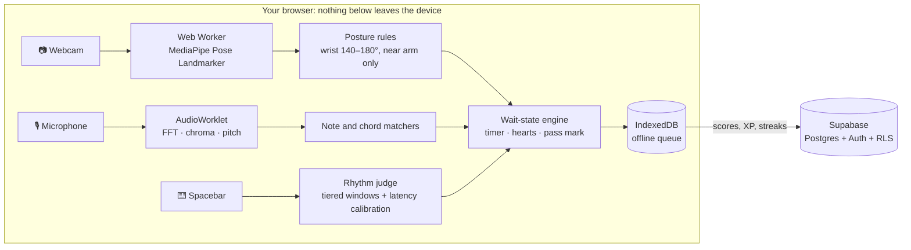

<div align="center">

<a href="https://muz-dawgz.vercel.app/">
  
</a>

<h1>MUZ</h1>

**Piano lessons that see and hear you.**

Sit at a real piano. MUZ watches your hands through the webcam, listens through the microphone,<br>
and only moves on when you actually play it right.

[](https://github.com/markuu-exe/MUZ/actions/workflows/ci.yml)


[**Live app**](https://muz-dawgz.vercel.app/) ·
[Features](#features) ·
[Quick start](#quick-start) ·
[How it works](#how-it-works) ·
[Docs](#documentation)

</div>

<br>

<p align="center">
  
</p>

> [!TIP]
> **Just want to look around?** Open the [live app](https://muz-dawgz.vercel.app/) and press **Try Demo Mode**. You get a sample learner (JohnPiano) with every lesson unlocked. Nothing is saved and no account is needed.

## Why MUZ

Most piano apps either need a MIDI cable or just play a video at you. Neither one notices that your wrist is collapsing or that you played an E where a G belongs.

MUZ uses the two sensors every laptop already has:

| | What it does | What it catches |
|---|---|---|
| 📷 **Camera** | Tracks your arm and wrist with on-device pose estimation | Dropped or raised wrists, a collapsed hand shape |
| 🎙️ **Microphone** | Hears single notes *and* full chords from any acoustic or digital piano | Wrong notes, missing chord tones, notes played out of time |
| ⌨️ **Spacebar** | Taps along to a metronome, calibrated to your device's latency | Rushing, dragging, missed beats |

Your camera and microphone are processed **entirely in the browser**. No audio or video ever leaves your device; only scores and progress are saved.

## Features

<table>
<tr>
<td width="50%" valign="top">

### 🌳 A skill tree, not a playlist
**12 units and 59 lessons** across three tiers: **Novice**, **Proficient** and **Virtuoso**. Each unit ends in a checkpoint, and each tier ends in an exam. Lessons unlock as you earn XP, and a placement test lets experienced players skip ahead.

</td>
<td width="50%" valign="top">

### 🎹 Lessons that wait for you
Practice lessons pause until the right note or chord rings out. You get 15 seconds and five hearts, and hearts refill over time. The first two units are a gentle warm-up with longer timers and no hearts lost.

</td>
</tr>
<tr>
<td valign="top">

### 🥁 Fair rhythm grading
A clock-accurate Web Audio metronome with its own **count-in voice**, so you know exactly when to start. Timing windows tighten with each tier. Tap along, echo a pattern back, or read it from the page. A short tap test measures your device's delay so the grading stays fair.

</td>
<td valign="top">

### 📖 Theory you can touch
Concept cards with staff and keyboard diagrams you can hear, then checks that ask you to name notes, find keys, build chords and pick out what you heard by ear. Every unit's notes stay readable in **Lesson Notes**.

</td>
</tr>
<tr>
<td valign="top">

### 📈 Progress you can see
XP, streaks, hearts and tiers in a HUD that's always visible, plus charts of pitch accuracy, rhythm consistency and posture stability on your profile.

</td>
<td valign="top">

### 🌗 Built for the piano bench
Dark and light themes, sound effects you can switch off and reduced-motion support. If your connection drops mid-lesson, progress is queued on the device and syncs when you're back online.

</td>
</tr>
</table>

<p align="center">
  <picture>
    <source media="(prefers-color-scheme: light)" srcset="docs/assets/readme/skill-tree-light.webp">
    
  </picture>
  <br>
  <sub>The skill tree. This picture follows your GitHub theme: switch it to see MUZ in light mode.</sub>
</p>

<table>
<tr>
<td width="50%"></td>
<td width="50%"></td>
</tr>
<tr>
<td align="center"><sub>Build-the-chord check, answered correctly</sub></td>
<td align="center"><sub>Lesson Notes for every unit, with diagrams you can play</sub></td>
</tr>
</table>

## Quick start

**You need:** Node.js 22, npm, and a Supabase project (the free tier is enough).

```bash
git clone https://github.com/markuu-exe/MUZ.git
cd MUZ
npm install
```

Create `.env.local` in the project root. It is git-ignored; never commit it.

```bash
VITE_SUPABASE_URL=https://<your-project>.supabase.co
VITE_SUPABASE_ANON_KEY=<your-anon-key>
```

Set up the database by running each file in [`supabase/migrations/`](supabase/migrations) in order, then [`supabase/seed.sql`](supabase/seed.sql), in the Supabase SQL editor. Then start the app:

```bash
npm run dev   # http://localhost:5173
```

> [!NOTE]
> MUZ is a desktop app. It needs a screen of at least **1280 × 720**, a webcam, a microphone and a current Chromium browser (Chrome or Edge). Once the app is running, **Demo Mode** lets you explore every screen without creating an account.

> [!WARNING]
> Never run `supabase db reset` against a hosted project: it wipes it. Only the anon (publishable) key belongs in the client; Row Level Security is what protects the data. See [`docs/ENVIRONMENTS.md`](docs/ENVIRONMENTS.md).

## How it works



| Layer | Where | Notes |
|---|---|---|
| **Vision** | [`src/vision`](src/vision), [`src/workers/posture.worker.ts`](src/workers/posture.worker.ts) | MediaPipe `pose_landmarker_lite` runs off the main thread. In a side view, only the arm nearest the camera is judged. |
| **Audio** | [`src/audio`](src/audio) | An AudioWorklet computes chroma and pitch (with [pitchy](https://github.com/ianprime0509/pitchy)) per frame. Matchers turn frames into "heard C major" or "heard E4". |
| **Rhythm** | [`src/lib/rhythm`](src/lib/rhythm), [`src/hooks/useRhythmSession.ts`](src/hooks/useRhythmSession.ts) | Clicks are scheduled on the audio clock, not timers, so the beat doesn't drift. |
| **Lessons** | [`src/content`](src/content), [`src/lesson`](src/lesson) | The course is typed TypeScript. `npm run seed:lessons` compiles it to SQL, and CI checks the two stay in sync. |
| **Progress** | [`src/lib/progress`](src/lib/progress), [`src/lib/sync`](src/lib/sync) | XP, hearts and streaks are written to Supabase, with an IndexedDB queue for offline lessons. |
| **UI** | [`src/components`](src/components) | React and Tailwind. Themes work by swapping CSS variables ([`src/styles/theme.css`](src/styles/theme.css)). |

## Scripts

| Command | What it does |
|---|---|
| `npm run dev` | Start the dev server on port 5173 |
| `npm run build` | Type-check and build to `dist/` |
| `npm test` | Run all unit, component and database tests (Vitest; database tests use an in-memory [PGlite](https://pglite.dev/)) |
| `npm run seed:lessons` | Regenerate `supabase/seed.sql` from the course in `src/content` |
| `npm run seed:lessons:check` | Fail if the seed is out of date (runs in CI) |
| `npm run eval:posture` | Score the posture rules against labelled clips |
| `npm run eval:audio` | Score note and chord detection against labelled recordings |

Every pull request runs the **`verify`** job: tests, type-check, build, the seed check, and a 5 MB bundle-size limit. It needs no secrets.

## Project structure

```text
src/
├── audio/        Microphone input, AudioWorklet DSP, note/chord matching, wait-state engine
├── vision/       Camera service, pose landmarks, posture rules and HUD
├── workers/      Pose estimation Web Worker
├── content/      The course: tiers, units, lessons, exercises and rhythm patterns
├── lesson/       Lesson runner and grading
├── practice/     Practice drills: framing gate, posture hold, chord reports
├── components/   React UI: landing, auth, dashboard, skill tree, lesson player, theory widgets
├── lib/          Supabase client, progress, offline sync, rhythm timing, theme, sounds
└── hooks/        Dashboard data, heart regeneration, rhythm session and judge
supabase/
├── migrations/   Schema and Row Level Security policies
├── seed.sql      Generated course data
└── __tests__/    RLS and policy tests on PGlite
docs/             Requirements, decisions, test reports and brand guide
```

## Documentation

| Document | What's in it |
|---|---|
| [`docs/execution/MUZ_SRS-Latest.pdf`](docs/execution/MUZ_SRS-Latest.pdf) | Software Requirements Specification |
| [`docs/execution/MUZ_SDD-Latest.pdf`](docs/execution/MUZ_SDD-Latest.pdf) | Software Design Description |
| [`docs/decisions/RULINGS.md`](docs/decisions/RULINGS.md) | Every product decision and why: warm-up units, wrist range, rhythm windows and more |
| [`docs/ENVIRONMENTS.md`](docs/ENVIRONMENTS.md) | Local, CI, staging and production setup |
| [`docs/test/`](docs/test) | Audio and posture evaluation methods, performance, media privacy and defect log |
| [`docs/brand/LOGO.md`](docs/brand/LOGO.md) | The MUZ logo: construction, variants and usage rules |

## Known limitations

We'd rather you hear these from us:

- **Progress is written by the client.** XP, hearts and streaks are protected by Row Level Security, but a determined user could edit their own values. Moving this into server-side functions is the next step.
- **Development and production share one Supabase project** for now.
- **Desktop only.** Phones and tablets get a friendly "use a bigger screen" message.
- **Accuracy depends on the room.** A loud room or a camera placed straight side-on can confuse detection. The app's framing check helps; a ¾ side angle works best.

## Team

MUZ is a capstone project by **Team DAWGZ** at Cebu Institute of Technology – University (CIT-U), 2026:
Amatong · Barnaija · Bernante · Rosales.

## Acknowledgements

- [MediaPipe](https://developers.google.com/mediapipe) for on-device pose estimation
- [pitchy](https://github.com/ianprime0509/pitchy) for pitch detection
- [Supabase](https://supabase.com/), [Vite](https://vitejs.dev/), [React](https://react.dev/), [Tailwind CSS](https://tailwindcss.com/), [Chart.js](https://www.chartjs.org/) and [Lucide](https://lucide.dev/)

<div align="center">
<br>

<br>
<sub>Made for everyone who ever practised scales alone.</sub>
</div>
