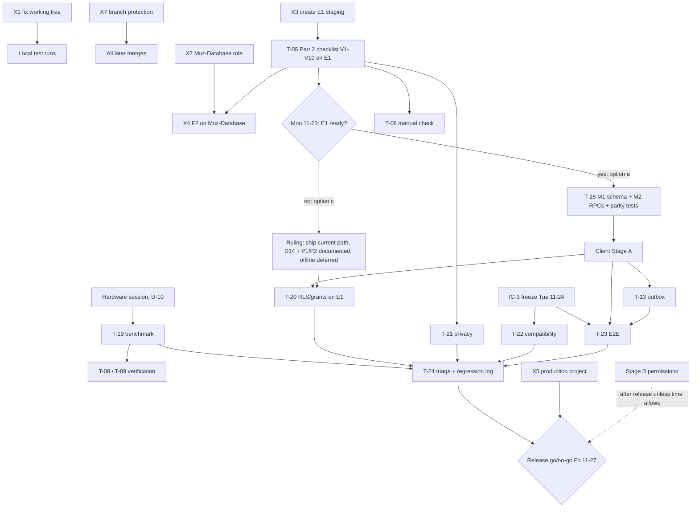

> **Superseded (2026-11-26).** Baseline `e96c34c` and the plan in §4 (staging E1, RPCs, Stage A/B) are stale. Current state: `docs/audit/RESCUE_AUDIT_2026-11-26.md` and `docs/audit/PHASE1_GUIDE_RECONCILIATION_2026-11-26.md`.

# MUZ Consolidated Handoff (Phase 4)

| | |
|---|---|
| **Date** | Sat 2026-11-21 |
| **Baseline** | `origin/main` @ `e96c34c` |
| **Scope** | Investigation, decisions and planning only. No application code, SQL, database, branch, PR or Jira change was made. |
| **Calendar** | Freeze Tue 11-24 · release Fri 11-27 · demo Sat 11-28 (U-01, `RULINGS.md`) |

## 1. Deliverables

| # | Deliverable | File | Status |
|---|---|---|---|
| 1 | Member A implementation audit | `docs/audit/MEMBER_A_IMPLEMENTATION_AUDIT.md` | Final (T-02 row corrected in Phase 3) |
| 2 | Progression architecture decision | `docs/audit/PROGRESSION_ARCHITECTURE_DECISION.md` | **Approved 2026-11-21 (all defaults).** Team ratification pending. |
| 3 | Decisions X1–X11 | §2 below | **Approved 2026-11-21 (all defaults)** by the project owner. X8 (team ratification) still has to happen. |
| 4 | Updated dependency map | §3 below | — |
| 5 | Prioritised next-step plan | §4 below | **Approved 2026-11-21.** Progress is tracked in §5. |
| — | Member C / D guide revision (earlier task) | `docs/execution/MEMBER_C_EXECUTION_GUIDE.md`, `MEMBER_D_EXECUTION_GUIDE.md`, `SECURITY_AUDIT_GUIDE_REVISION.md` | Written; needs a follow-up edit for the approvals (N-9) |

**Headline facts**
- Member A: 0 of 7 tasks implemented *and* verified. T-06, T-09 and T-08 are implemented but lack their manual/hardware checks. T-01, T-02 and T-19 are partial. T-24 is not started.
- No PR since #18 has an independent approving review; `main` is unprotected.
- A implemented C's T-05, T-07 and F2 without a recorded decision.
- Jira has not been updated since 11-16. The SPMP Issue Log is empty.
- No hardware or performance target has been measured.
- The hosted database (`Muz-Database`) has not been identified and is known to be insecure (anonymous read/write on `profiles`, per the audit summary).

---

## 2. Decisions that still require your input

Recommended default first. These are all outside the approved architecture document.

| # | Decision | Recommended default | Trade-off | Needed by |
|---|---|---|---|---|
| **X1** | The working-tree conflict on `task/SEC-AUDIT-guide-revision`: someone ran `git stash pop` (`package-lock.json` unmerged, `package.json` staged with a `supabase ^3.2.0` dev dependency, `stash@{0}` kept) | Undo the pop on this branch (restore both files to `HEAD`) and keep `stash@{0}`. If the team wants the Supabase CLI as a dev dependency, add it in its own PR. | Undoing loses nothing (the stash still holds it). Resolving in place mixes a dependency change into a docs branch. | Before any local test run |
| **X2** | Role of `Muz-Database` (U-22) | Record it as **shared dev with real user data**: neither staging nor production. It currently serves local dev and Vercel previews (`ENVIRONMENTS.md`). | Calling it "staging" invites destructive testing on real profiles. | Sun 11-22 |
| **X3** | Fresh isolated staging E1 (U-28, revisits U-08) | **Create E1 now**, built only from the migrations in timestamp order; point Vercel previews at it. | Costs about half a day. Without it, T-20/T-23 and the Stage A rule cannot run. | **Mon 11-23** (schedule rule, architecture §11 row 16) |
| **X4** | Apply F2 to `Muz-Database` before the progression work (U-26) | **Yes:** backup first, test on E1 first, then apply. It closes anonymous read/write of every profile and removes no legitimate client path. | Small risk on a database whose exact state is unknown. Waiting leaves a P0 open until after release. | Mon 11-23 |
| **X5** | Production database (U-06) | A **fresh project** built from migrations (E3), not a promoted `Muz-Database`. | Real users' existing profiles would not carry over. | Wed 11-25 |
| **X6** | Owner of T-28 (the RPCs) and of SEC-01 (grants) | **T-28: A writes, C reviews.** SEC-01: C writes, A reviews. That gives every database change an independent reviewer. | A is already over capacity, but has been writing this code anyway. | Sun 11-22 |
| **X7** | Review rule | Turn on branch protection: PR required, 1 approval from **someone other than the author**. B reviews A's PRs; A reviews B/C/D's. | Slows merges in the last week, but no merge so far has had an independent review. | Today |
| **X8** | Team ratification (SPMP 3.3) of PA-D1…PA-D15, especially PA-D10 (reverses ruling D14) and PA-D7 (offline required) | A 20-minute change-control meeting; record the outcomes in `RULINGS.md` (new rows, IDs that don't clash). | Without it the approval is one person's. | Mon 11-23 |
| **X9** | Retroactive record of A doing C's T-05, T-07 and F2 | Add one line each to `RULINGS.md` §3 (who decided, when, why). Close C's superseded `task/T-07-pitch-verifier` branch. | — | Mon 11-23 |
| **X10** | B's T-11 (achievements) | **Re-scope** to "UI reads `user_achievements`; remove the mock badges" (evaluation moves into the RPC, PA-D13). If Stage A is not shipped, remove the mock badge list and show "not available". | Shipping fake "unlocked" badges is misleading at the defence. | Tue 11-24 |
| **X11** | Remaining guide decisions | U-25 onboarding "once" = **once per account, using placement** (already account-level). U-33 A applies migrations on hosted projects. U-34 apply `is_dev` + `dev_test_results` on E1. U-35 cap consistency at 100 only. U-36 keep T-17 cut. U-37 HUD wording from A. U-27 → X6. U-29 decided only if Muz-Database is ever reconciled. | — | As each task starts |

---

## 3. Updated dependency map

| Item | Hard dependencies | Notes |
|---|---|---|
| T-28 M1/M2 | Architecture approved (done); X3 (E1); X6 (owner) | PGlite tests can start before E1 exists |
| Client Stage A | T-28 M2 merged | Touches `src/lib/progress/**` (B's area), `runner.ts`/`types.ts` (A), `DashboardScreen.tsx` (D first, then B/C), `useHeartRegen.ts` |
| T-13 outbox (13.3) | Stage A | PA-D7 makes it required; cutting it needs a ruling |
| Stage B (D14 reversed) | Stage A verified on E1; old client retired | Recommended **after** release unless Stage A finishes early |
| T-20 | E1 + V1–V10; F2 on E1; the matrix for whichever stage is live | Stage A → D14 matrix; Stage B → §8 matrix of the architecture document |
| T-23 | IC-3; E1; † rows need Stage A | Under option (c), † rows are `n/a` with the ruling ID |
| T-19 | Hardware (U-10); latency method | T-08 and T-09 code is merged |
| T-24 | T-19…T-23 results | Defect log must first be brought up to date (N-8) |
| F2 on Muz-Database | X2, X4, backup, E1 test | Independent of the progression work |

---

## 4. Prioritised next-step plan (approved 2026-11-21)

Ordered by blocking dependencies, then security/data-loss risk, then correctness, then verification, then release impact. Owners follow the guides' area table. Where A is named for another member's area, X6/X9 must record it.

| # | When | Step | Owner | Done when |
|---|---|---|---|---|
| **N-1** | Today | X1: restore `package.json` / `package-lock.json` on the docs branch; keep `stash@{0}` | whoever ran the pop, or A | `git status` clean except docs |
| **N-2** | Today | X7: enable branch protection on `main` | A (admin) | Protection API no longer returns 404 |
| **N-3** | Sun 11-22 | X2, X5, X6 decisions recorded in `docs/ENVIRONMENTS.md` / `RULINGS.md` | A | Rows recorded |
| **N-4** | Sun 11-22 → Mon 11-23 | X3: create E1; apply the 4 migrations in order; seed; T-05 checklist V1–V10; point Vercel previews at E1 | C (A applies if U-33 = A only) | V1–V10 recorded |
| **N-5** | Mon 11-23 | **Schedule gate:** E1 ready → option (a); otherwise (c) with a ruling (architecture §11 row 16) | A | Branch recorded |
| **N-6** | Mon 11-23 | X4: backup `Muz-Database`; apply F2 there after E1 test; anonymous REST check | A (C prepares) | Anonymous `profiles` request returns no rows |
| **N-7** | Mon 11-23 (in parallel) | T-19 hardware session: two machines, Chrome + Edge, chords, notes, latency; closes T-08/T-09 verification | A (C notes, D records) | `PERFORMANCE_REPORT.md` §2–§8 filled; fails logged |
| **N-8** | Mon 11-23 | Bring `DEFECT_LOG_AND_TRIAGE.md` to repository truth; choose a single system of record (repo log or Issue Log sheet) | A | DEF-003/004/005/006 statuses correct |
| **N-9** | Mon 11-23 | Edit the C/D guides for the approved architecture (U-23, U-24, D14-R → resolved); X10 re-scope of T-11 | A | Guides no longer say BLOCKED on resolved items |
| **N-10** | Mon 11-23 → Wed 11-25 *(option a)* | T-28: M1 + M2 + PGlite parity tests; client Stage A | A writes, C reviews (X6) | Architecture §10 tests green; E2E-25…31 on E1 |
| **N-11** | Tue 11-24 | IC-3 freeze. **Freeze exception needed for N-10/N-12 under option (a).** Record it. | A | Exception recorded |
| **N-12** | Wed 11-25 *(option a)* | T-13 outbox over `submit_lesson_result` | C | T-13 manual steps 3–7 |
| **N-13** | Tue 11-24 → Wed 11-25 | T-06 manual check on E1; T-21 privacy audit on E1 | A; D | Evidence posted |
| **N-14** | Wed 11-25 → Thu 11-26 | T-20 on E1 (matrix per live stage); T-22; T-23 | C; D; C (+ B) | Reports in `docs/test/` |
| **N-15** | Thu 11-26 → Fri 11-27 | T-24 triage, fixes in area order, `REGRESSION_LOG`; go/no-go per guide §4.7 | A | Go/no-go recorded |
| **N-16** | Fri 11-27 | Production (E3): migrations in order, deploy, smoke test | B (A approves) | Smoke test witnessed |
| **N-17** | Any time before 11-27 | Jira reconciliation (audit §E); create NEW-01/02/04/05; reopen KAN-228/229/10/11/258 | A | Board matches the audit |
| **N-18** | Thu 11-26 → Fri 11-27 | T-26: v01.02 revision rows; SDD 3.3 security text per PA-D5/PA-D10 describing the **delivered** stage; offline status per PA-D7 | A (D: test appendix) | A signs off |
| **N-19** | After release | Stage B (revoke direct writes) and T-20 re-run; PA-D9 `start_lesson` reassessment | A + C | §8 matrix verified |

**Option (c) variant.** Drop N-10 and N-12. Add a ruling that records:
- ruling D14 as still in force;
- P1 (non-atomic saves) and P2 (no idempotency) as known defects;
- offline sync deferred (PA-D7 requires the ruling);
- T-23's † rows as `n/a`.

Everything else stands.

**Capacity warning.** Since 11-16, almost all merged work came from A's account. B, C and D have one merged PR between them (B's #22, reverted). The plan names B, C and D for steps they have not yet shown progress on (N-4, N-12, N-13, N-14). If they cannot deliver by Mon 11-23, option (c) is the realistic path, and verification (N-7, N-13, N-14) should take priority over new features.

---

## 5. Progress log

| Date | Step | Result |
|---|---|---|
| 2026-11-21 | N-1 (X1) | `package.json` / `package-lock.json` restored to `HEAD` on `task/SEC-AUDIT-guide-revision`; `stash@{0}` (the `supabase ^3.2.0` dev dependency) kept untouched for its owner. |
| 2026-11-21 | Local verification after N-1 | `npm ci`, then on `e96c34c` + docs: `npx vitest run` 49/49 files, 599/599 tests; `npx tsc` clean; `npm run build` OK (JS 829 kB + CSS 59 kB); seed up to date (59 lessons); `git status` showed only docs after the build, so **T-01's "build leaves the tree clean" criterion is now verified**. |
| 2026-11-21 | N-9 (guide part) | Member C / D guides updated for the approved architecture and the X11 defaults. T-11 re-scope (X10) is recorded here, not in B's guide (out of this revision's scope). |

## 6. Limits of this audit

- Team chat, adviser communication and checkpoint posts were not accessible. Anything that depends on them is marked "Cannot verify".
- The hosted security audit and the Copilot audit reports were used only as summarised in the handoff; neither file was available.
- No hosted database was inspected.
- No manual, browser or hardware check was performed.
- The Supabase PGlite suites were not run locally (missing package); CI ran them green on `e96c34c`.
