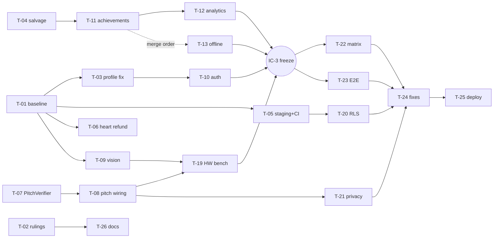

# Dependency and Parallel Work Plan

This plan uses the task IDs in [TASK_DECOMPOSITION.md](TASK_DECOMPOSITION.md). Day numbers (D1…D15) are working days and match [DEVELOPMENT_ROADMAP.md](DEVELOPMENT_ROADMAP.md).

## 1. Dependency classes

| Class | Meaning |
|---|---|
| **HARD** | The task cannot meaningfully proceed, or cannot be accepted, until the other task is complete |
| **SOFT** | The task can start against an agreed interface, mock or stub; it only *merges* after the other task |
| **INDEPENDENT** | The task needs only the T-01 baseline |

No dependency below exists only because two tasks share a feature. Each has a concrete technical reason.

## 2. Dependency table

| Task | Depends on | Class | Reason |
|---|---|---|---|
| All code tasks | T-01 | HARD | One baseline. Today `origin/main` lacks COURSE-6 and `course-handoff` has 2 unpushed commits. |
| T-03 | T-01 | HARD | — |
| T-03 acceptance | T-05 | HARD (acceptance only) | Needs a staging project to test the offline profile-read case |
| T-04 | — | INDEPENDENT | A review and decision task |
| T-05 | T-01 | HARD | CI runs on `main` |
| T-06 | T-01 | INDEPENDENT otherwise | Touches only `runner.ts`, `PracticeDrillView.tsx`, `LessonPlayer.tsx` |
| T-07 | T-02 D4 | SOFT | The default is to keep the SRS, so C can start |
| T-07 | T-08 (interface only) | SOFT | Agree the `AcousticFrame` fields `pitchHz` and `clarity` on D1 |
| T-08 | T-07 | HARD for merge, SOFT to start | Wiring needs the verifier |
| T-09 | T-01 | INDEPENDENT | Vision-only files |
| T-10 | T-03 | HARD | Same file (`AuthContext.tsx`) and same owner; sequential |
| T-10 | T-05 | HARD for acceptance | OAuth redirects and recovery emails need staging |
| T-10 | T-15 | SOFT (merge order) | Both edit `App.tsx`; T-15 merges first |
| T-11 | T-04 | HARD | The salvage decision fixes what to port |
| T-12 | T-04 | HARD | Same reason |
| T-12 | T-11 | SOFT | The badges grid can render an empty list |
| T-12 | T-15 | SOFT (merge order) | Both are near `DashboardScreen.tsx`; T-15 merges first, and T-12 touches it only to pass props |
| T-13 | T-11 | SOFT (merge order) | Both edit `saveLessonResult.ts` and `supabaseStore.ts`; T-11 merges first |
| T-13 migration | A approval | HARD | Schema change control (SPMP 3.3) |
| T-14 | T-02 D8 | SOFT | Placement tiers stay as they are by default |
| T-15 | T-01 | INDEPENDENT | — |
| T-16 tests | T-01 | INDEPENDENT | — |
| T-16 formula | T-02 D13 | HARD | The formula is a team decision |
| T-17 | T-01 | INDEPENDENT | — |
| T-18 | T-01 | INDEPENDENT | The file list is fixed; T-07 removes the two audio files |
| T-19 | T-08, T-09 | HARD | Measures the final pipeline using T-09's overlay |
| T-20 | T-05 | HARD | Needs the live staging database |
| T-21 | T-08 | HARD | Must audit the final audio path |
| T-22 | IC-3 | HARD | Tests the frozen feature set |
| T-23 | IC-3, T-05 | HARD | Same, on staging |
| T-24 | T-19…T-23 | HARD | Needs the defect list |
| T-25 | T-24 | HARD | Release candidate |
| T-26 | T-02 | HARD | Edits follow the rulings; the test appendix comes from T-19…T-23 |



**Auxiliary dependency (added 2026-11-19, outside the T-graph).** C's F2 `profiles` fix (RULINGS §4.3; `T-02_VERIFICATION_PLAN_HANDOFF.md` F2) → **A:** verify F2 → backup → apply the `is_dev` migration → run the check script → grant test accounts → manual checks → record results and notify (AUX-TEST-ACCESS-01, `docs/auxiliary/AUX_TEST_ACCESS_IS_DEV_DESIGN.md` §11). It is hard on F2 and changes no T-xx dependency.

## 3. Critical path

**T-01 (D1) → T-04 (D1) → T-11 (D2–D3) → T-12 (D4–D7) → IC-3 (D9) → T-22 ∥ T-23 (D10–D12) → T-24 (D12–D13) → T-25 (D14)**

| Path | Days | Slack to IC-3 |
|---|---|---|
| B chain (analytics) | D1–D7 | 1.5 days |
| Pitch / hardware chain: T-05 (D1–D2) → T-07 (D2–D4) → T-08 (D5–D6) → T-19 (D7–D8) | D1–D8 | about 1 day. This is also the highest-*risk* chain, because of unknown real-hardware results. |

**Blocking tasks**, meaning tasks others wait on: T-01, T-04, T-05, T-07, IC-3, T-24.

**Integration bottlenecks**
- `saveLessonResult.ts` / `supabaseStore.ts`: T-11 merges, then T-13.
- `DashboardScreen.tsx` / `App.tsx`: T-15 merges, then T-12 and T-10.
- The `AcousticFrame` type: A owns it.

## 4. Start-immediately vs must-wait

| Can start D1 (after T-01's push, about 2 hours) | Must wait |
|---|---|
| T-02 (A), T-03 (B), T-04 (B), T-05 (C), T-06 (A), T-16 tests (D) | T-07 can start D2 once the interface is agreed on D1 |
| D2: T-09 (A), T-15 (D), T-17 (D, scheduled D6) and T-18 (D, scheduled D4) can start at any time | T-08 waits for T-07 to merge (D4) |
| | T-10 after T-03 (B, D8 by plan) |
| | T-11 and T-12 after T-04 |
| | T-13 after T-11 is merged (D3) |
| | T-19 after T-08 and T-09 |
| | T-20 after T-05 |
| | T-21 after T-08 |
| | T-22 and T-23 after IC-3 |
| | T-24, then T-25 |

## 5. Parallel workstreams

| Stream | Owner | Independent scope | Interface agreement needed | Shared files / conflict risk | Integration requirement | Integrator |
|---|---|---|---|---|---|---|
| **S-A Runtime (audio + vision)** | A | T-06, T-09, T-08, T-19 | `AcousticFrame` + `pitchHz` / `clarity` (with C, D1); worklet message in `audio/worklet/protocol.ts` | `ChordVerifier.ts` (type only), `PracticeDrill.ts` | `notes` / `PracticeDrill` / `waitState` tests stay green; T-19 report | A |
| **S-B Gamification and auth** | B | T-03, T-04, T-11, T-12, T-10, then T-25 | `ProgressStore` additions (`getUnlockedAchievements`, `insertAchievements`); the `useAnalyticsData` return shape (both in T-11 / T-12) | `saveLessonResult.ts`, `supabaseStore.ts` (with C); `AuthContext.tsx` (B only); `App.tsx` and `DashboardScreen.tsx` (with D) | `applyResult` / `saveLessonResult` tests; staging check | A |
| **S-C Backend and quality** | C | T-05, T-07, T-13, T-20, T-23 | `AcousticVerifier` (existing); `SyncQueueItem` + `run_id` migration (approved by A) | `saveLessonResult.ts` / `supabaseStore.ts` (after B); `src/audio/config.ts` (with A) | `queue.test.ts`, `pitch.test.ts`; RLS script output | A |
| **S-D UI and verification** | D | T-16, T-15, T-18, T-14, T-17, T-21, T-22, T-26 | None. Every D task has fixed files and rules. | `DashboardScreen.tsx`, `App.tsx` (D merges first); `notes.ts` / `GrandStaff.tsx` (D only) | Review by A (C for T-17 and the theory files in T-18) | A |

### Data contracts to agree before the parallel work starts

All four are agreed on D1 and written in each PR description.

**1. `AcousticFrame` (A ↔ C)**

```ts
export interface AcousticFrame {
  tMs: number; chroma: ArrayLike<number>; voiced: boolean; ringing?: boolean;
  onset: boolean; onsetMs: number;
  /** T-08: pitchy f0 estimate for this hop; null when unvoiced. */
  pitchHz?: number | null;
  /** T-08: pitchy clarity 0..1. */
  clarity?: number;
}
```

**2. `ProgressStore` additions (B ↔ C ↔ A)**

```ts
getUnlockedAchievements(userId: string): Promise<Set<string>>;
getAchievementRewards(): Promise<Record<string, number>>;
insertAchievements(userId: string, ids: string[]): Promise<void>; // plain insert, ignore 23505
// C, T-13: a QueuedProgressStore decorator implements the same interface; no signature change.
```

**3. `runId: string`** on `LessonRunState` and `LessonResult` (C, T-13; set once in `createLessonRun`, since `buildLessonResult` runs twice on quit), plus the migration `performance_records.run_id uuid unique`.

**4. `useAnalyticsData(userId, range)`**: the return shape is fixed in T-12. D's badges styling, if B asks for it, consumes `badges: {id, title, unlockedAt}[]`.

## 6. Merge order inside each checkpoint

1. **IC-1 (D3):** T-15 (D) → T-16 (D) → T-06 (A) → T-03 (B) → T-11 (B) → T-05 (C; its workflow file does not conflict).
2. **IC-2 (D6):** T-18 (D) → T-07 (C) → T-09 (A) → T-08 (A) → T-14 (D).
3. **IC-3 (D9):** T-17 (D) → T-13 (C) → T-12 (B) → T-10 (B).

Rebase on `main` before every merge. A merges, and runs the full CI suite after each merge.
